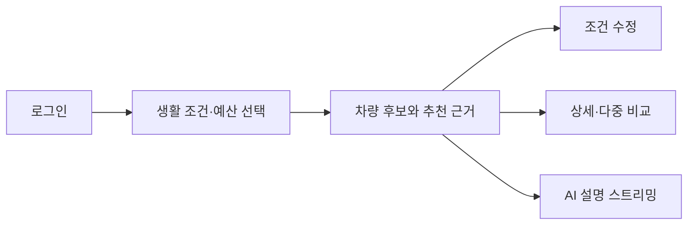

# Mobility Choice

**생활 조건과 예산을 바탕으로 차량 후보를 좁히고, 선택의 근거를 비교하는 차량 탐색 서비스입니다.**

## 문제 정의

차량 선택에는 예산·차종·동력 방식·필수 옵션 등 여러 기준이 함께 작용합니다. 제조사별로 흩어진 정보를 오가며 비교해야 하는 부담을 줄이고, 후보가 제안된 이유를 이해할 수 있는 탐색 경험을 만들었습니다.

## 핵심 경험

| 화면 | 사용자 가치 |
|---|---|
| 조건 선택 | 여러 차종·동력·필수 옵션과 예산을 한 번에 설정 |
| 추천 목록 | 후보와 조건 일치 근거를 함께 확인 |
| 상세 정보 | 가격·제원·옵션과 공식 출처 비교 |
| 다중 비교 | 선택한 차량의 차이를 나란히 파악 |
| AI 설명 | 규칙으로 정한 후보의 추천 이유를 자연어로 확인 |

## 추천 구조

예산·차종·동력·국산/수입·필수 기능을 만족하는 후보를 먼저 찾고 가격 순으로 정렬합니다. 선택한 기능은 모두 충족해야 하며, 여러 차종은 그중 하나와 일치하면 후보가 됩니다. 설명 모델은 차량 순위를 만들거나 제원을 생성하는 대신 주어진 후보의 근거를 전달합니다.

## 기술 스택

| 영역 | 기술·역할 |
|---|---|
| 웹 | Next.js, React, CSS Modules · 조건 선택과 차량 비교 |
| 차량 API | Express, MongoDB, Mongoose · 차량·사용자 정보 |
| 인증 | JWT, bcrypt · 인증과 비밀번호 해시 |
| 추천 API | Python, FastAPI · 필수 조건 필터와 후보 정렬 |
| 설명 | Ollama, LangChain, SSE · 추천 이유 생성과 스트리밍 |

## 설계 포인트와 범위

점수만 제시하는 대신 사람이 이해할 수 있는 조건 태그를 보여주고, 결과 화면에서 조건을 바로 바꿀 수 있도록 했습니다. 차량 정보에는 공식 출처·확인일·가격과 옵션의 주의사항을 함께 관리합니다.

화면에서 수집하는 모든 생활 조건이 랭킹에 반영되는 것은 아닙니다. 추천은 필수 조건 중심이며, 가격·트림·옵션은 시점과 사양에 따라 달라질 수 있습니다. AI 설명은 차량 데이터의 사실성을 보장하는 별도 출처가 아닙니다.
